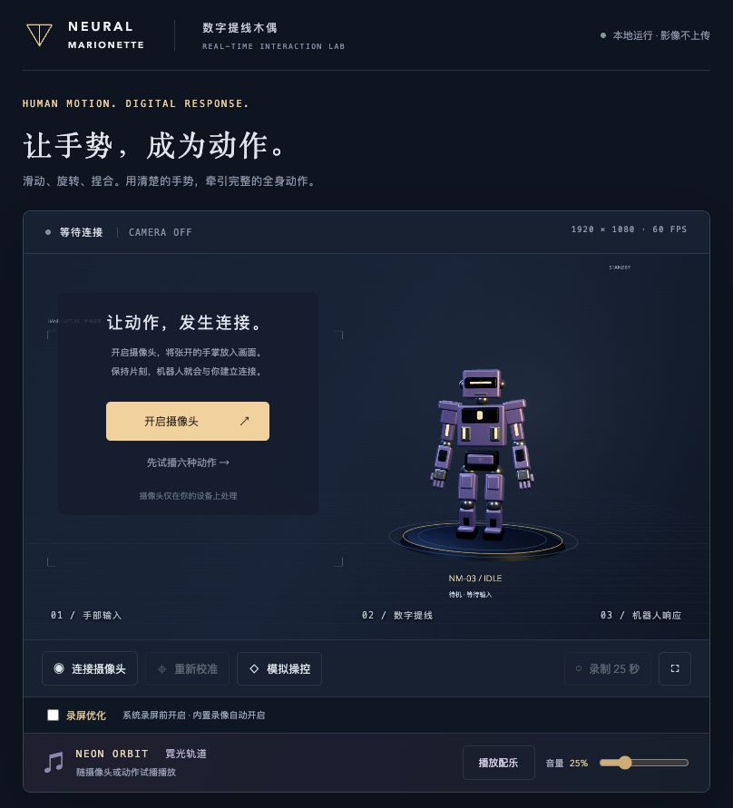

# Neural Marionette · 数字提线木偶

用摄像头捕捉手部动作，实时操控一个 3D 机器人。

Neural Marionette 是一个在浏览器本地运行的手势交互项目。它将手部关键点转换为动作指令，让机器人完成疾跑、旋身跃起、负重、下蹲和跳跃，并用五条发光提线呈现手与机器人的连接。你可以使用内置手势，也可以示范自己的手势，为某个动作单独建立绑定。



*上图为摄像头关闭状态的项目界面，不包含真人影像。*

[手势录制说明](neural-marionette/docs/GESTURE_STUDIO.md) · [操作手册](neural-marionette/docs/controls.md)

## 功能

- **实时手部追踪**：MediaPipe 提取单手 21 个关键点，在 Web Worker 中完成推理。
- **六种全身动作**：待机、疾跑、旋身跃起、负重、下蹲、跳跃，包含蓄力、腾空、落地和动作过渡。
- **手势录制与绑定**：倒计时后录下一段手势，回放骨架，确认后绑定到指定动作。每个动作最多保存三段样本。
- **混合识别**：只自定义需要调整的动作，其余动作继续使用内置规则。
- **3D 交互舞台**：机械机器人、发光提线、粒子、运动轨迹，以及镜像、画质和位置跟随调节。
- **科幻背景配乐**：原创电子氛围曲《霓光轨道》，随操控循环播放，支持暂停、音量调节和偏好保存；详见 [配乐说明](neural-marionette/docs/SOUNDTRACK.md)。
- **本地保存与调试**：样本 JSON 导入导出、诊断导出、最长 25 秒舞台录像；无需摄像头也能试播动作。

当前实现使用 **JavaScript、Three.js、MediaPipe 和 Vite**。运行不需要 TouchDesigner、Python 服务、API Key 或大模型账号；界面中的动作状态尚未连接真实的 Agent 任务或后台计算。

## 快速开始

### 环境

- Node.js 22.12 或更高版本及 npm。
- 桌面 Chrome、支持 WebGL2 的显卡；当前主要在 macOS + Chrome 下验证。
- 使用真人手势时需要摄像头和浏览器摄像头权限。

克隆或下载本仓库后，在**仓库根目录**打开终端：

```sh
cd neural-marionette
npm ci
npm run assets
npm run dev -- --port 5173 --strictPort
```

打开 [http://127.0.0.1:5173](http://127.0.0.1:5173)。不要直接双击 `index.html`。

`npm ci` 按锁文件安装依赖。`npm run assets` 准备本地推理资源：复制 WASM 和 MediaPipe bundle，缺少模型时从 Google 官方模型库下载。首次安装需要联网，资源准备完成后应用运行不依赖外部服务。

macOS 用户完成上述安装后，也可以双击 [`启动数字提线木偶.command`](neural-marionette/启动数字提线木偶.command) 启动。

### 第一次使用

1. 点击「开启摄像头」并允许访问。
2. 将一只张开的手放入画面，保持片刻，确认 21 点骨架跟随手部。
3. 按下表做手势，观察机器人动作。
4. 若只想看动画，点击动作库或按数字键 `1–6` 进入试播。试播会关闭摄像头；结束后点击「返回摄像头手势控制」。

## 默认手势

| 机器人动作 | 手部动作 | 试播快捷键 |
| --- | --- | --- |
| 待机 | 张开手掌，放松停留 | `1` |
| 疾跑 | 食指、中指朝下伸出，其余手指收起，前后摆动 | `2` |
| 旋身跃起 | 只伸出食指，其余收起，像转钥匙一样转动手腕 | `3` |
| 负重 | 拇指与食指捏合并保持，松开卸力 | `4` |
| 下蹲 | 握拳向下压，保持拳头维持下蹲 | `5` |
| 跳跃 | 下蹲后快速上提并张手，完成一次跳跃 | `6` |

疾跑需要持续运动，静止保持双指手型不会启动。旋身跃起与跳跃会先完成落地，再切换动作。尽量保持整只手可见，减少遮挡与手掌侧对摄像头的情况。

## 录制自己的手势

在舞台下方的「录制并绑定我的手势」面板中：

1. 连接摄像头，选择要绑定的机器人动作，例如「疾跑」。
2. 摄像头与追踪模型就绪后，点击「录制我的手势」。点击时不必把手留在镜头里：利用 **2 秒倒计时**把操作鼠标的手放回画面，随后在约 1.6 秒内自然做一次完整动作。
3. 观看骨架回放，点击「保存并绑定」。不满意可重录或取消。
4. 再做同样的手势，观察识别结果。必要时补录不同速度或位置的样本。

摄像头未连接、模型正在加载或已在倒计时／录制时，录制按钮会变灰；预览下方会显示连接与手部检测状态。「保存并绑定」只有在录制成功并出现骨架回放后才能点击。空白或不完整的手势会提示重录。

保存后自动启用**混合模式**，无需录全六种动作。

| 识别方式 | 已录制的动作 | 未录制的动作 |
| --- | --- | --- |
| 混合模式（推荐） | 使用个人样本，停用该动作的旧规则 | 继续使用内置规则 |
| 原有手势规则 | 使用内置规则 | 使用内置规则 |
| 仅我的录制手势 | 使用个人样本 | 不触发，保持待机 |

例如：只录制「疾跑」，就可以让疾跑按自己的习惯触发，而旋身跃起、负重、下蹲、跳跃与待机继续沿用原来的手势。

混合模式中，匹配成功的个人动作优先。切换模式不会删除样本；刷新页面后，有样本时默认启用混合模式，无样本时默认使用原有规则。

### 样本与隐私

- 摄像头画面和手部推理在本机处理；应用不上传摄像头影像，不启用麦克风。
- 手势样本只保存关键点、采样时间、画面宽高比与动作标签，不保存摄像头视频。
- 样本保存在**当前浏览器、当前站点地址的 localStorage**，不在 Git 仓库内。更换浏览器、主机名或端口不会自动迁移样本，清除站点数据会丢失样本。
- 使用「导出样本给我分析」下载 JSON 备份；换环境后可导入。「导入并替换样本」会替换当前样本集合。
- 「录制 25 秒」是另一个独立功能：保存舞台合成视频，可能包含摄像头画面，与手势关键点录制不同。

更多细节见 [手势录制与绑定](neural-marionette/docs/GESTURE_STUDIO.md)。

### 录制舞台视频

内置「录制 25 秒」会自动启用 **720p / 30 帧录屏优化**，结束后恢复原画质。使用 macOS 区域录屏时，先手动勾选舞台下方的「录屏优化」，录完取消勾选。优先导出 H.264 MP4，浏览器不支持时回退 WebM；当前视频不包含配乐或麦克风。详见 [录屏性能与排查](neural-marionette/docs/RECORDING.md)。

## 实现方式

```text
摄像头画面
    ↓
MediaPipe Hand Landmarker（Web Worker / WASM）
    ↓ 21 个手部关键点
内置手势规则 + 个人轨迹样本匹配
    ↓ 按识别模式选择动作指令
动作状态机与程序化动画
    ↓
Three.js 渲染机器人与 3D 场景
    ↓
Canvas 2D 合成摄像头、机器人、提线与文字
    ↓
实时显示 / MediaRecorder 导出舞台录像
```

个人手势采用短时轨迹匹配，通过动态时间规整（DTW）比较手型与运动过程，结合运动幅度和相似度决定是否触发；录制过程不会训练一个新的神经网络。

界面中的「推理耗时」指 MediaPipe 单次手部识别的耗时，不是大模型推理，也不等同于从移动手掌到机器人响应的总延迟。总响应还受到摄像头采样、手势观察窗口、状态切换和渲染影响。

## 开发与构建

以下命令在 `neural-marionette/` 中执行：

```sh
npm test
npm run build
npm run preview -- --port 5173 --strictPort
```

构建结果位于 `neural-marionette/dist/`。预览前先停止占用相同端口的开发服务器。`preview` 用于本机检查构建结果；对外部署时应使用 HTTPS，以便浏览器访问摄像头。

当前有 37 项单元测试，覆盖追踪状态、动作切换、手型区分、轨迹匹配、混合模式路由，以及无手时启动倒计时、空样本拒绝和已有样本保留。浏览器流程测试位于 `tests/`，使用 Python Playwright；部分脚本含本机浏览器路径，换电脑运行前需按 [安装说明](neural-marionette/docs/setup.md) 配置。普通运行无需安装 Python。公开仓库不附带测试产生的截图、录像或静态手部图片；需要静态图片的 `model_test.py` 应自行准备夹具，说明见 [公开版本范围](PUBLIC_RELEASE.md)。

### 目录结构

```text
.
├── README.md
└── neural-marionette/
    ├── src/
    │   ├── main.js               # 摄像头、界面与主循环
    │   ├── core.js               # 追踪状态、滤波与坐标映射
    │   ├── actions.js            # 内置手势规则与动作编排
    │   ├── robot.js              # 机器人与 3D 场景
    │   ├── gesture-samples.js    # 录制、样本匹配与混合路由
    │   ├── gesture-studio.js     # 录制面板与本地存储
    │   ├── recorder.js           # 舞台录像、编码回退与资源释放
    │   └── music.js              # 背景配乐与音量控制
    ├── public/                  # Worker、模型、WASM 与本地配乐
    ├── config/                  # 相机、渲染与映射配置
    ├── scripts/                 # 资源准备、配乐生成与启动脚本
    ├── tests/                   # 单元测试和浏览器测试
    └── docs/                    # 设计说明、操作手册与唯一的摄像头关闭截图
```

## 当前边界与常见问题

**这是一个可运行的交互原型。** 自动测试和演示中的合成手势不代表真人识别准确率；长时间真人使用、不同设备与复杂光照下的表现仍需持续验证。这里不承诺固定帧率或零延迟。

- **摄像头无法连接**：检查 Chrome 站点权限与系统摄像头权限，确认使用本地 HTTP 地址；关闭连接后再重试。
- **手势识别不稳定**：先看骨架是否跟手。若关键点已错位，优先调整光线、角度和遮挡；若骨架正常但规则不适合自己，可仅为该动作录制样本。
- **手势录制按钮变灰**：等待摄像头和模型就绪；切换到后台会关闭摄像头，返回页面需要重新连接。「保存并绑定」必须等录制成功后才能点击。
- **动作显得卡顿**：切换到轻量画质，结合诊断中的推理时间与渲染表现检查。
- **录像时卡顿**：内置录像自动开启录屏优化；系统录屏需手动开启。避免同时使用两份录像工具。独立 Chrome 的测试已验证约 25 秒、30 FPS 的输出，实际设备与系统录屏仍需分别验证。
- **刷新后找不到样本**：确认仍使用同一浏览器和完整地址。`localhost` 与 `127.0.0.1`、不同端口分别保存数据。

更多排查方法见 [故障处理](neural-marionette/docs/troubleshooting.md)。

## 项目文档

- [从黑盒到白盒：技术栈与实现原理培训教程](neural-marionette/docs/TECHNICAL_TRAINING.md)
- [安装与启动](neural-marionette/docs/setup.md)
- [操作与参数](neural-marionette/docs/controls.md)
- [手势录制与混合模式](neural-marionette/docs/GESTURE_STUDIO.md)
- [舞台录像、录屏优化与性能排查](neural-marionette/docs/RECORDING.md)
- [背景配乐与播放控制](neural-marionette/docs/SOUNDTRACK.md)
- [动作强化与手型设计](neural-marionette/docs/MOTION_V3.md)
- [基础架构说明](neural-marionette/docs/architecture.md)
- [原型审核与效果标准](neural-marionette/docs/AUDIT_AND_UPGRADED_SPEC.md)
- [更新记录](neural-marionette/CHANGELOG.md)
- [公开版本范围](PUBLIC_RELEASE.md)
- [原始需求文档](<数字提线木偶_手势实时操控 3D 机器人.md>)

## 许可与资源来源

仓库目前尚未设置项目级 `LICENSE`。第三方依赖与模型的来源记录见 [资源与许可说明](neural-marionette/assets/licenses/README.md)；该记录不替代项目自身的许可证。

公开仓库仅包含当前项目源码、必要运行资源、文档和一张摄像头关闭状态的截图。原始需求文档保留用于了解项目起点，当前实现以本 README 为准。参考视频、摄像头截图、演示录像、个人手势样本及本地旧提交历史均不公开。
